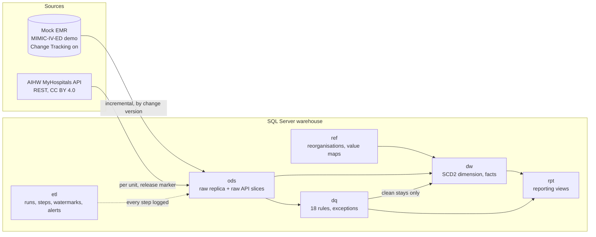

# ED Data Integration Pipeline


A SQL Server data pipeline for emergency department (ED) data. It replicates a source hospital system
incrementally, ingests published hospital performance data from a public REST API, validates everything
against explicit quality rules, and publishes a dimensional warehouse with reporting views.

It is built to the standards of a production pipeline: versioned migrations, idempotent runs, run logging,
quality rules stored as data, a quarantine for bad records, and CI that deploys the whole thing to a clean
SQL Server 2022 on every push.

## What it does

| Stage | What happens | Where |
|---|---|---|
| Replicate | Changes in a mock hospital system (built from the public MIMIC-IV-ED demo) are copied to the warehouse near real time using SQL Server Change Tracking. | `src/edpipe/replicate.py` |
| Ingest | The AIHW MyHospitals API is read one reporting unit at a time, checked against the API's own totals, and loaded only when a new data release is published. | `src/edpipe/aihw_ingest.py` |
| Model | Hospitals are loaded as a Type 2 dimension so history survives reorganisations such as the Bayside Health merger (1 January 2026). Measures go to a fact table. | `src/edpipe/dw_build.py` |
| Validate | 18 data quality rules run against ED stays. Failing records are quarantined, never published, and each problem is tracked until fixed. | `src/edpipe/dq.py` |
| Report | Reporting views expose clean stays, network level results, and the quality state of the pipeline. | `rpt` schema |

## Architecture



Schemas: `ods` (raw), `ref` (reference data), `dq` (rules and exceptions), `dw` (dimension and facts),
`rpt` (reporting views), `etl` (control tables). Raw data is never edited after load.

## Results on the included data

* **Live API run:** 28,353 measure rows from 213 requests in 153 seconds, each unit reconciled to the API's total.
* **Data quality on 222 ED stays:** 220 published, 2 quarantined (vital signs recorded before the patient arrived).
  Warnings are recorded but do not block publishing, for example 37 implausible temperatures, 24 pain scores that
  are genuine free text, and 15 stays with no triage category.
* **Bayside Health merger:** five services (Alfred Health, Peninsula Health, Bass Coast Health, Gippsland Southern
  Health Service, Kooweerup Regional Health Service) roll up into one network from 1 January 2026, with history
  kept for the old groupings. Combined four hour ED share fell from 77.6% (2018-19) to 60.7% (2024-25).
* **Tests:** about 80 automated tests (unit, plus integration tests against a real SQL Server). Integration tests
  inject crafted defects, such as duplicates, vitals before arrival and an unmatched reorganisation, to prove each
  rule fires.

## Engineering decisions

Full reasoning, including what each choice costs, is in [docs/design-decisions.md](docs/design-decisions.md).

* **Change Tracking, not CDC.** CDC needs SQL Server Agent, which Express does not have. The pipeline needs the
  current state of a row, not its history. If the warehouse falls behind the retention window it detects that,
  reloads in full and raises an alert.
* **Rules as data.** Quality rules live in `dq.quality_rule` with a severity (Error or Warning). Adding a rule is
  an insert, not a code change. Exceptions have a lifecycle (Open, Resolved, reopened with the same id).
* **Quarantine, do not delete.** Stays that fail an Error rule are excluded from `dw.fact_ed_stay` and listed in
  `rpt.dq_quarantine`. The raw record stays in `ods` for investigation.
* **One reporting unit at a time.** Paging the API without a filter returned 971 duplicate rows out of 45,210.
  Per unit extracts are clean, and duplicates fail the run rather than being silently dropped.
* **Release marker, not timestamps.** The API publishes `data_version`. An unchanged version is a no-op.
* **Type 2 dimension with effective dates.** A dated reorganisation starts a new version on its effective date,
  even if the pipeline learns of it later.
* **Migrations are never edited.** Each migration has a SHA-256 checksum, and editing an applied script fails the
  deploy. Fixes ship as a new numbered migration.
* **Withheld is not zero.** Suppressed figures are stored as NULL with their code and a `Withheld` status.

## Limitations

* The mock EMR is the public MIMIC-IV-ED demo (222 stays). Its dates are shifted into the 2100s and its triage
  scale is the US ESI, not the Australian ATS.
* Recorded AIHW data ends at 2024-25, and AIHW still maps hospitals to their pre-merger networks. No real period
  falls after the Bayside merger yet, so tests simulate a 2025-26 release.
* The combined Bayside figure is not strictly like for like across years: Bass Coast Hospital enters in 2019-20.
* The facts table is rebuilt in full each run. That is simpler and cannot drift at this size, but it would change
  at a hundred million rows.

## Quick start (Windows, SQL Server Express)

```powershell
python -m venv .venv; .\.venv\Scripts\Activate.ps1
pip install -e ".[dev]"
Copy-Item config\dev.env.example config\dev.env   # Windows authentication by default
.\scripts\deploy.ps1 -Environment dev             # create databases, apply migrations
pytest -m "not integration"                       # unit tests, no database needed
```

Run the pipeline after deploying:

```powershell
python -m edpipe.sources.emr_sim reset            # prepare the mock EMR
python -m edpipe.sources.emr_sim replay --all     # replay the demo data into it
python -m edpipe.replicate                        # copy changes to the warehouse
python -m edpipe.aihw_ingest                      # ingest AIHW data (add --force to reload)
python -m edpipe.dw_build                         # build dimension and facts
python -m edpipe.dq                               # run the data quality rules
python -m edpipe.health                           # row counts, runs, failures, open alerts
```

`deploy.ps1 -DryRun` shows pending migrations without applying them.

## Continuous integration

On every push GitHub Actions lints, runs the unit tests, then deploys to a fresh SQL Server 2022 container,
checks that a second deploy changes nothing, runs the integration tests, and runs the data quality rules on the
replicated demo data. A weekly workflow runs the real AIHW API into a throwaway database.

## Data and licences

* AIHW MyHospitals data: Australian Institute of Health and Welfare, CC BY 4.0.
* MIMIC-IV-ED demo: PhysioNet, credit to the Beth Israel Deaconess Medical Center team. Used under the Open Database
  License (ODbL).
* Bayside Health merger details: Premier of Victoria announcement, 29 August 2025.
* Code: MIT, see [LICENSE](LICENSE).
