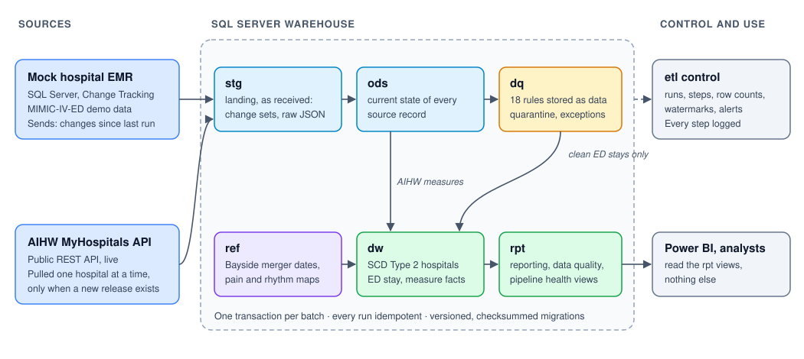

# ED Data Integration Pipeline

[](https://github.com/anson4747/ed-data-integration-pipeline/actions/workflows/ci.yml)
[](https://github.com/anson4747/ed-data-integration-pipeline/actions/workflows/aihw-live.yml)


An end to end data pipeline for **emergency department (ED) data in Victoria**, built on SQL Server. It takes data
from two very different sources, a hospital system (EMR) and a public government API, checks it against explicit
quality rules, and publishes a dimensional warehouse that reports can trust.

It is built the way a production pipeline in a health service should be: every database change is a versioned
migration, every run is logged and safe to repeat, bad records are quarantined rather than deleted, and CI deploys
the whole system to a clean SQL Server on every push.

### At a glance

* **Sources**: Mock hospital EMR loaded with real, de-identified MIMIC-IV-ED demo data, and the live AIHW MyHospitals REST API
* **Techniques**: Change Tracking replication, release-aware API ingestion, SCD Type 2 dimension, rules-as-data quality framework, quarantine, run logging and alerting
* **Stack**: SQL Server 2022 / Express, T-SQL, Python 3.12, PowerShell, GitHub Actions, pytest
* **Scale on the included data**: 28,353 API rows per live load, 222 ED stays, 18 quality rules, 14 warehouse migrations, 98 automated tests
* **Real-world twist**: Models the **Bayside Health merger** (Alfred Health and four other services, 1 January 2026) so reports stay correct before and after it

---

## Contents

1. [Why this project](#why-this-project)
2. [Architecture](#architecture)
3. [Technology choices and why](#technology-choices-and-why)
4. [How it works](#how-it-works)
5. [Results](#results)
6. [Challenges and how they were solved](#challenges-and-how-they-were-solved)
7. [Testing and CI](#testing-and-ci)
8. [Operating it](#operating-it)
9. [Run it yourself](#run-it-yourself)
10. [Repository map](#repository-map)
11. [Limitations and next steps](#limitations-and-next-steps)
12. [Data and licences](#data-and-licences)

---

## Why this project

Victorian health services report ED activity to the state through the Victorian Emergency Minimum Dataset (VEMD),
and the public sees hospital performance through AIHW MyHospitals. A data pipeline team sits between the two: it
pulls data out of clinical systems, reconciles it with external reference data, validates it, and makes it reliable
for reporting.

This project builds that pipeline at small scale with real data, and deliberately includes the hard parts of the
real job:

* **Incremental loads** from a live source system without re-reading everything.
* **An external API that misbehaves**: duplicate rows, timeouts, and a gateway that blocks default clients.
* **An organisational change.** On 1 January 2026 Alfred Health, Peninsula Health, Bass Coast Health, Gippsland
  Southern Health Service and Kooweerup Regional Health Service merged into Bayside Health. Reports must group
  hospitals by the network they belonged to *at the time*, while AIHW still publishes the old networks.
* **Messy clinical data**: free text in numeric fields, implausible vital signs, records that contradict each other.

## Architecture

<p align="center">
  
</p>

| Layer | Holds | Rule |
|---|---|---|
| `stg` | Each batch exactly as received (change sets, raw API JSON) | Reloaded per batch |
| `ods` | Current copy of every source record | Changed only by the apply procedures, one transaction per batch |
| `ref` | Curated reference data: network reorganisations, pain and rhythm value maps | Versioned in migrations, with source URLs |
| `dq` | The rule catalogue and every finding (open, resolved, reopened) | Rules are rows, not code |
| `dw` | `dim_reporting_unit` (SCD Type 2), `fact_ed_measure`, `fact_ed_stay` | Built only from data that passed the Error rules |
| `rpt` | Views for reporting, data quality and pipeline health | The only layer a report should read |
| `etl` | Pipeline runs, steps, row counts, watermarks, alerts | Every step writes here, success or failure |

## Technology choices and why

| Choice | Why | Trade-off accepted |
|---|---|---|
| **SQL Server, runs on Express** | The common platform in Victorian health services. Targeting Express means it also runs on the free edition | No SQL Agent, so no CDC and no built-in scheduler (solved below) |
| **Change Tracking**, not CDC or timestamps | Returns exactly the rows changed since the last version, including deletes, and needs no SQL Agent | Sees the latest state, not every intermediate change. That is what reporting needs |
| **T-SQL procedures for set-based work** | Applying change batches, building the dimension and running rules are set operations the database does best, inside transactions | Logic is split between Python and SQL, each doing what it is good at |
| **Python for orchestration and I/O** | HTTP with retries, paging, reconciliation, logging and command line entry points. Only two runtime dependencies (`pyodbc`, `requests`) | |
| **Versioned migrations with checksums** (own small runner) | Every environment is built the same way from scripts. Editing an applied script is detected and blocks the deploy | A fix is always a new migration, so some objects appear twice in history |
| **PowerShell** for deploy and run | What Windows operators and Task Scheduler expect. Works on Windows PowerShell 5.1 and PowerShell 7 | |
| **GitHub Actions with a SQL Server 2022 container** | Every push deploys from scratch, redeploys to prove nothing changes, and runs the whole pipeline on a real database | Live API calls run in a separate weekly workflow so CI stays deterministic |
| **pytest and ruff** | Unit tests need no database; integration tests run against SQL Server with crafted bad data | |

## How it works

**1. Replicate the EMR, near real time.** The mock EMR is a SQL Server database loaded from the MIMIC-IV-ED demo,
with an event queue that releases records over time to imitate live hospital activity. Each run asks Change Tracking
for everything changed since the stored version, lands it in `stg`, and applies inserts, updates and deletes to `ods`
in one transaction. The extract runs under snapshot isolation so the version number and the changes agree. If the
warehouse ever falls behind Change Tracking's retention window, the run notices, reloads that table in full and
raises an alert.

**2. Ingest the AIHW API, only when there is a new release.** The API publishes a `data_version`. If it has not
changed, the run does nothing. If it has, the pipeline asks the API which hospitals have data for each measure,
extracts **one reporting unit at a time**, checks each extract against the API's own row total, lands the raw JSON,
and replaces the stored release in one transaction. Suppressed figures such as "NP" are kept as NULL with their code
and a `Withheld` status, never as zero.

**3. Model it with history preserved.** `dw.dim_reporting_unit` is an SCD Type 2 dimension: one row per hospital per
period of network membership. The Bayside Health merger is a dated row in `ref.lhn_reorganisation`, so the five
services' hospitals move to Bayside from 1 January 2026 even though AIHW still shows the old networks. Reports can
group by the network at the time, or restate history under today's structure.

**4. Validate it with rules stored as data.** 18 rules live in `dq.quality_rule`: 9 Errors and 9 Warnings. Several
are modelled on VEMD 2026-27 validations. An Error quarantines the stay: it stays in `ods`, is listed with its reason
in `rpt.dq_quarantine`, and is left out of `dw.fact_ed_stay`. A Warning is published and counted. Each finding has a
lifecycle (Open, Resolved, and Reopened with the same id), so every problem has an audit trail.

<details>
<summary><b>All 18 rules</b></summary>

| Rule | Severity | Checks |
|---|---|---|
| `E025_DUPLICATE_PRESENTATION` | Error | Two presentations for the same patient at the same arrival time (VEMD E025) |
| `E340_DEPARTURE_NOT_AFTER_ARRIVAL` | Error | Departure not after arrival (VEMD E340) |
| `E167_VITALS_BEFORE_ARRIVAL` | Error | Vital signs charted before the patient arrived (VEMD E167, applied to charting times) |
| `E219_LENGTH_OF_STAY_OVER_7_DAYS` | Error | ED stay longer than 7 days (VEMD E219/E350 upper bound) |
| `ORPHAN_TRIAGE` | Error | Triage record whose ED stay does not exist |
| `ORPHAN_VITALSIGN` | Error | Vital sign whose ED stay does not exist |
| `ACUITY_NOT_ESI_LEVEL` | Error | Acuity present but not an ESI level 1 to 5 |
| `ADMITTED_WITHOUT_ADMISSION` | Error | Disposition "admitted" but no hospital admission record |
| `ADMISSION_DISCHARGE_BEFORE_ADMIT` | Error | Discharge before admission, for an admission that began in ED |
| `LENGTH_OF_STAY_OVER_72H` | Warning | ED stay between 72 hours and 7 days: possible, but check |
| `TRIAGE_ACUITY_MISSING` | Warning | No triage record, or triage without an acuity |
| `O2SAT_IMPLAUSIBLE` | Warning | Oxygen saturation below 70% or above 100% |
| `HEARTRATE_IMPLAUSIBLE` | Warning | Heart rate below 20 or above 250 |
| `TEMPERATURE_IMPLAUSIBLE_F` | Warning | Temperature outside 85 to 108 °F (MIMIC records Fahrenheit) |
| `DIASTOLIC_ABOVE_SYSTOLIC` | Warning | Diastolic above systolic, usually transposed values |
| `PAIN_UNPARSEABLE` | Warning | Pain neither a 0 to 10 score nor a mapped term |
| `RHYTHM_NOT_IN_VOCABULARY` | Warning | Heart rhythm text not in `ref.rhythm_map` |
| `LANGUAGE_UNKNOWN` | Warning | Preferred language recorded as "?" |

</details>

**5. Operate it.** One command runs every step in order and stops at the first failure. Every step records itself
in `etl`, failures raise alerts, and `rpt.pipeline_health` gives one row per pipeline: Healthy, Attention, Failing or
Running. See [Operating it](#operating-it).

## Results

**Live AIHW load**, from the weekly workflow against the real API: 28,353 measure rows from 213 requests in 153
seconds, every extract reconciled to the API's own total, no duplicates.

**Data quality on the 222 demo ED stays:**

| Outcome | Count |
|---|---|
| Stays published to `dw.fact_ed_stay` | 220 |
| Stays quarantined (vital signs charted before arrival, E167) | 2 |
| Warning: implausible temperature | 37 |
| Warning: pain score is genuine free text, left for a person to review | 24 |
| Warning: language unknown | 20 |
| Warning: no triage category | 15 |
| Warning: diastolic above systolic, stay over 72 hours, implausible O2 saturation | 2, 2, 1 |

**Bayside Health, from AIHW data:** the combined share of ED patients leaving within four hours fell from **77.6% in
2018-19 to 60.7% in 2024-25**, weighted by presentations. The report carries a caveat: the hospital count rises from
4 to 5 in 2019-20, when Bass Coast enters the series.

## Challenges and how they were solved

Each of these was found by running the pipeline, not planned in advance.

| # | Problem found | Why it mattered | Fix |
|---|---|---|---|
| 1 | **The AIHW API returned duplicates under deep paging**: 971 duplicate rows in 45,210 | Silent double counting in every report | Extract one reporting unit at a time, reconcile each to the API total, and **fail the run** on duplicates instead of quietly removing them, which would hide a source fault |
| 2 | **Large unfiltered requests timed out**; one category walk took about 11 minutes | Slow, fragile loads | Per-unit requests answer in under a second; the whole live load takes about 2.5 minutes |
| 3 | **The API gateway returned 403** to the default Python client | The first live run failed | Send an identifying User-Agent. A first attempt using `setdefault` silently did nothing because `requests` already sets one; caught and now covered by a unit test |
| 4 | **The API returns 200 with zero rows** for unknown categories and out-of-range pages | "No data" could pass as success | An empty answer is never proof. A category empty for every hospital fails the run |
| 5 | **AIHW still maps hospitals to pre-merger networks** | Bayside Health does not exist in the source | Curated, dated `ref.lhn_reorganisation` with source URLs, applied through the SCD Type 2 dimension |
| 6 | **Periods that straddle the merger**: FY 2025-26 is half before, half after | Any choice changes the numbers | Assign to the version valid on the period's last day. Prorating would invent figures. Documented in [design decisions](docs/design-decisions.md) |
| 7 | **A reorganisation row matching no hospital was ignored silently**, found in review | A typo would mean the merger never applies, with no signal | New migration V010 raises a Warning alert |
| 8 | **Pooled ODBC connections leaked session state**: a reused connection kept an open transaction, so work was rolled back on close | Intermittent failures that are hard to reproduce | Disabled ODBC pooling; set and restore the isolation level explicitly around the snapshot extract |
| 9 | **Run status `SucceededWithWarnings` did not fit `varchar(20)`** | Runs failed at the logging step | Widened in a new migration (V004), never by editing the applied one |
| 10 | **`RULE` is a reserved word in T-SQL** | `dq.rule` broke the deploy | Renamed to `dq.quality_rule` before release |
| 11 | **Clinical free text in numeric fields**: "asleep", "unable", "denies" as pain scores; one rhythm spelled many ways | Can't cast, can't aggregate | Reference maps (`ref.pain_value_map`, `ref.rhythm_map`) seeded from the real values. Genuinely unclear text is flagged, not guessed |
| 12 | **SQL Server Express has no SQL Agent** | No CDC, no built-in scheduler | Change Tracking for replication; a PowerShell runner scheduled by Windows Task Scheduler |
| 13 | **Windows PowerShell 5.1 turns native stderr output into an error** | The runner could report the wrong exit code | The runner relaxes error handling only around the Python call and trusts the exit code |

## Testing and CI

**98 automated tests**: 40 unit tests that need no database and 58 integration tests against a real SQL Server.
Integration tests inject crafted defects, such as duplicate stays, vitals before arrival, an unknown reporting unit,
a revised API release, an unmatched reorganisation and a broken rule, and assert the pipeline catches each one.

Every push runs [CI](.github/workflows/ci.yml):

1. Lint (`ruff`) and unit tests.
2. Deploy every migration to a fresh SQL Server 2022 container, the way an operator would (`deploy.ps1`).
3. Deploy again and assert nothing changed (idempotency).
4. Integration tests.
5. Replay the demo EMR, replicate it, run the quality rules, and publish the report on the run summary.
6. Run the full pipeline with the PowerShell runner and assert no pipeline is Failing. Then break a step on purpose
   and assert the runner stops there and exits non-zero.

A separate [weekly workflow](.github/workflows/aihw-live.yml) loads the **real AIHW API** into a throwaway database.
CI proves the logic against a recorded sample; the weekly run proves the real service still behaves the same way.

## Operating it

```powershell
.\scripts\run-pipeline.ps1 -Environment prod      # replicate, ingest, build, validate, health report
```

```sql
SELECT * FROM rpt.pipeline_health;               -- one row per pipeline
SELECT * FROM rpt.dq_quarantine;                 -- stays held back, with reasons
SELECT * FROM etl.alert WHERE acknowledged_at_utc IS NULL;
```

The [runbook](docs/runbook.md) covers scheduling with Task Scheduler, what each alert type means, common failures
and their fixes, recovering a run stuck in Running, and acknowledging alerts. Every step is idempotent, so the answer
to most failures is: fix the cause, run it again.

## Run it yourself

Needs Windows with SQL Server (Express is fine), Python 3.10 or later, and ODBC Driver 18 for SQL Server.

```powershell
python -m venv .venv; .\.venv\Scripts\Activate.ps1
pip install -e ".[dev]"
Copy-Item config\dev.env.example config\dev.env     # Windows authentication by default
.\scripts\deploy.ps1 -Environment dev               # create databases, apply migrations (-DryRun to preview)
python -m edpipe.sources.emr_sim load               # download and verify the MIMIC demo, load the mock EMR
python -m edpipe.sources.emr_sim reset
python -m edpipe.sources.emr_sim replay --all       # release the demo activity
.\scripts\run-pipeline.ps1 -Environment dev         # the whole pipeline
pytest -m "not integration"                         # unit tests, no database needed
```

Each step can also run on its own, for example `python -m edpipe.dq` or `python -m edpipe.aihw_ingest --force`.

## Repository map

```
db/
  bootstrap/              create databases, enable Change Tracking and snapshot isolation
  source_emr/migrations/  mock EMR: schemas, tables, replay queue (V001 to V005)
  warehouse/migrations/   warehouse: layers, apply procedures, SCD2, facts, rules, views (V001 to V014)
src/edpipe/
  replicate.py            Change Tracking replication
  aihw_ingest.py          release-aware AIHW ingest (sources/aihw.py is the API client)
  dw_build.py             dimension and fact build
  dq.py                   data quality runner
  health.py               health report
  runlog.py               run, step and alert logging used by every entry point
  migrate.py              migration runner with checksum drift detection
  sources/emr_sim.py      mock EMR loader and replay
scripts/                  deploy.ps1, run-pipeline.ps1
tests/                    unit/ and integration/, plus a recorded AIHW sample
docs/                     design decisions, AIHW API findings, runbook
.github/workflows/        CI, weekly live load, API probes, source profiling
```

## Limitations and next steps

Stated plainly, because a reviewer will find them anyway.

* **Demo data, not a real hospital feed.** 222 stays from MIMIC-IV-ED, a US dataset: dates are shifted into the
  2100s and triage uses the US ESI scale, not the Australasian Triage Scale.
* **No real post-merger period yet.** AIHW data ends at 2024-25 and still shows the old networks, so the behaviour
  after 1 January 2026 is proven with a simulated release in the tests.
* **The facts are rebuilt in full each run.** Correct and simple at this size; at hundreds of millions of rows it
  would become an incremental merge.
* **A killed run stays in `Running`** until an operator marks it failed; there is no automatic timeout yet.

Next steps, in order: cross-check AIHW hospital identities against a second public hospital list; map ESI to the
Australasian Triage Scale; add a REDCap export source; move to CDC where the edition supports SQL Agent.

More detail: [design decisions and their costs](docs/design-decisions.md) and
[what probing the AIHW API showed](docs/aihw-api-notes.md).

## Data and licences

* **AIHW MyHospitals**: Australian Institute of Health and Welfare, [CC BY 4.0](https://creativecommons.org/licenses/by/4.0/).
* **MIMIC-IV-ED demo 2.2 and MIMIC-IV demo 2.2**: PhysioNet, [ODbL 1.0](https://opendatacommons.org/licenses/odbl/1-0/).
  Downloaded and checksum-verified at run time; never committed to this repository.
* **Bayside Health merger**: [Premier of Victoria, 29 August 2025](https://www.premier.vic.gov.au/bayside-health-voluntary-merger-strengthen-care).
* Full attributions in [DATA_LICENCES.md](DATA_LICENCES.md). Code: [MIT](LICENSE).

---

Built by **Anson Sebastian**, Melbourne · [LinkedIn](https://www.linkedin.com/in/anson-sebastian) · [GitHub](https://github.com/anson4747)
